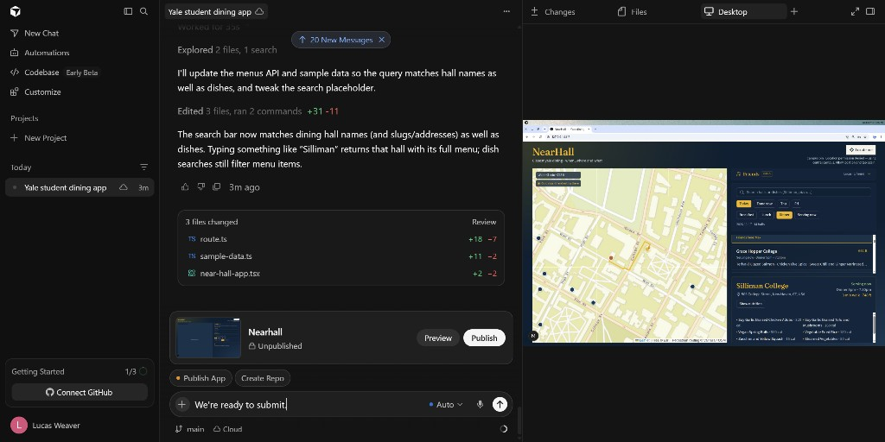

# NearHall

Map-first Yale dining finder for hackathon demos: nearest halls, open hours, and today’s menus.



## What it does

- Pulls residential + retail dining locations from Yale Hospitality’s public **Nutrislice** API
- Uses browser geolocation (campus-focused) to sort halls by distance
- Lets you filter by meal period, “open now,” and dish search (e.g. `pizza`)

## Run locally

```bash
npm install
npm run dev
```

Open [http://127.0.0.1:4317](http://127.0.0.1:4317).

## Notes

- Live menus come from `yalehospitality.api.nutrislice.com`. If that request fails, the app falls back to labeled **sample data**.
- This is a proximity / decision tool, not a full clone of YaleMenus.
- Geolocation needs HTTPS or localhost; deny permission and the list still works without distance sort.

## Friends demo (optional)

Auth + friends + “I’m eating here” check-ins are behind a kill switch:

```ts
// src/lib/social/config.ts
export const SOCIAL_ENABLED = true; // set false to hide social UI + APIs
```

Locally, data uses in-memory **PGlite**. Published apps with `cursor-app.json` get Postgres via `DATABASE_URL`.
